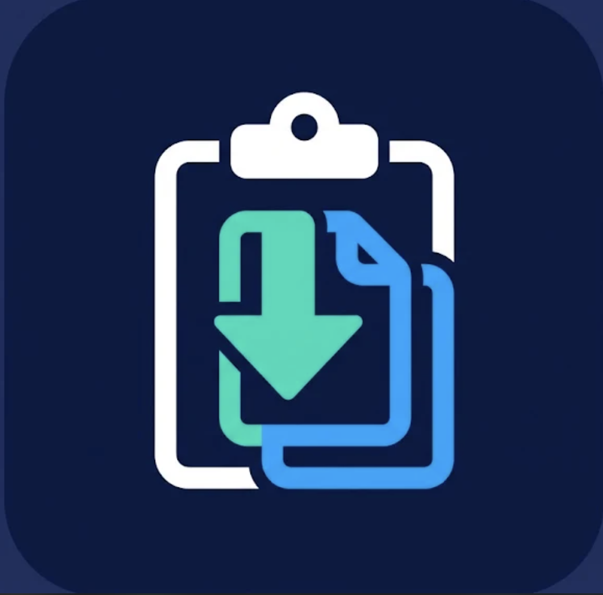
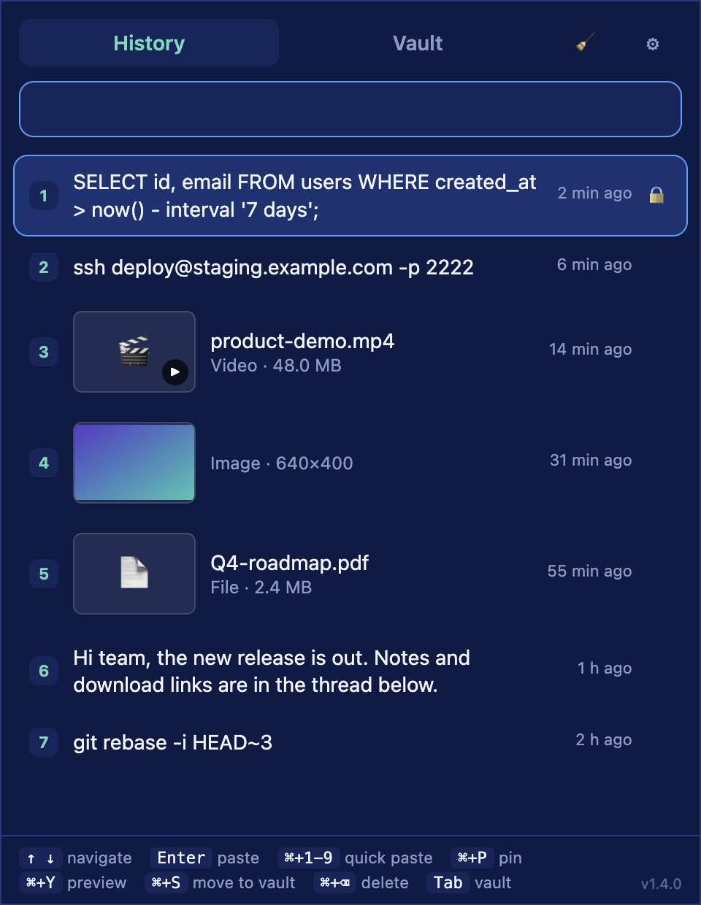
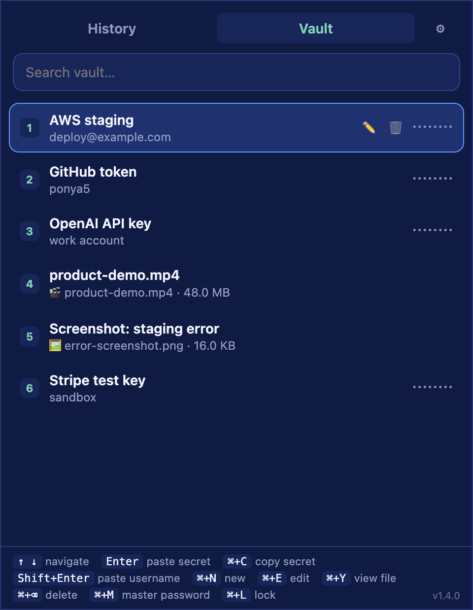
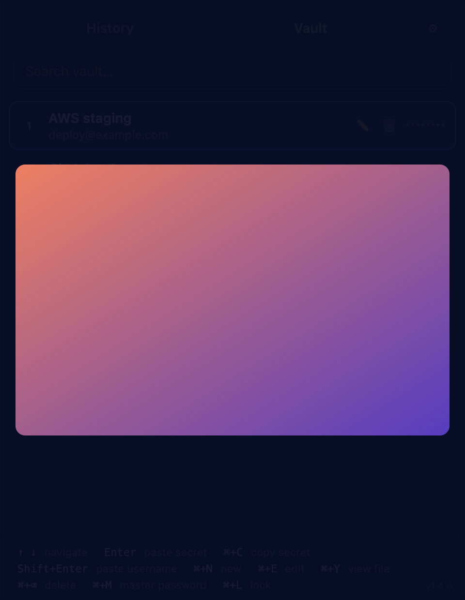
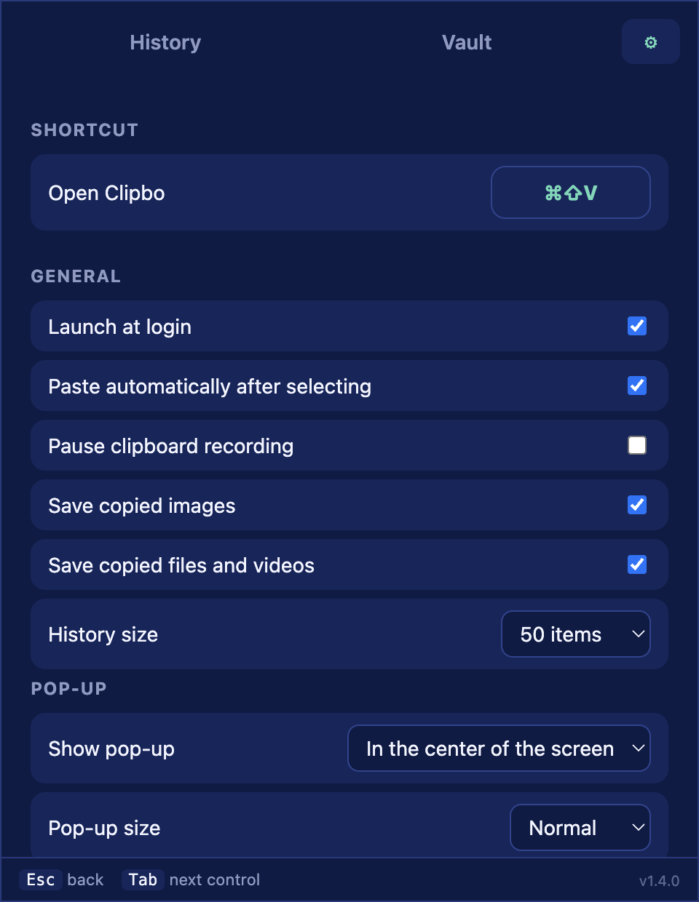

<p align="center">
  
</p>

<h1 align="center">Clipbo</h1>

<p align="center">
  <strong>Your clipboard history and your keys, one shortcut away.</strong><br>
  A fast clipboard manager with an encrypted vault for macOS and Windows.
</p>

<p align="center">
  
  
</p>

## Screenshots

<p align="center">
  
  
</p>
<p align="center">
  
  
</p>

> The screenshots use made-up demo data.

## Why Clipbo

You copy something, then copy something else, and the first thing is gone. Clipbo remembers everything you copy, lets you pick it back in a second, and keeps your important keys in a safe place.

- **Never lose a copy.** Text, images, files and videos are saved automatically, with thumbnails and a full preview.
- **Paste in one step.** Open Clipbo, search, select. It pastes into the app you were using.
- **A real vault.** API keys, passwords, screenshots, videos and files live in an encrypted vault. They never expire and are never mixed into your history.
- **Private by design.** No accounts, no cloud, no tracking. Nothing leaves your computer.
- **Keyboard-first.** Everything works without touching the mouse.

## Features

**Clipboard history**
- Saves text, images, files and **videos**, with thumbnails
- Quick preview: play a copied video or view an image full size before pasting
- Instant search, pin items you always need, one-click clear (pinned items are kept)
- Duplicates are merged, history size is yours to choose
- Copies from password managers (1Password, Bitwarden and others that mark them as secret) are never recorded

**Encrypted vault**
- Protected by a master password and strong encryption (AES-256-GCM, scrypt key derivation)
- Store passwords and API keys **and** screenshots, videos and files
- **Move to vault** with one click (🔒) or `Cmd/Ctrl+S` from any history item; the plaintext history copy is removed, and original files are moved to the Trash (optional)
- View, edit and delete entries; view an encrypted screenshot or video without leaving the vault
- Paste a secret, or copy it without pasting; built-in password generator
- Secrets are cleared from the clipboard after a time you choose (or never)
- Auto-locks after a time you choose, and when your computer sleeps; brute-force lockout
- Encrypted backup and restore, including attachments

**Make it yours (Settings screen)**
- Change the global shortcut by simply pressing the new keys
- Choose how the pop-up appears: centered or next to your mouse, and its size
- Thumbnail size and style
- Paste automatically or just copy, pause recording, choose what gets saved
- Vault auto-lock, clipboard clearing, lock on sleep, generated password length

**Everyday comfort**
- Lives in the menu bar or system tray, optional launch at login
- Automatic updates from GitHub Releases
- Error log for troubleshooting
- Works on macOS (Intel and Apple Silicon) and Windows

## Keyboard shortcuts

| Key | Action |
| --- | --- |
| `Cmd/Ctrl+Shift+V` | Open Clipbo (changeable) |
| `Up` / `Down`, `Enter` | Navigate, paste |
| `Cmd/Ctrl+1-9` | Quick paste |
| `Cmd/Ctrl+P` | Pin (History) |
| `Cmd/Ctrl+Y` | Preview |
| `Cmd/Ctrl+S` | Move to vault |
| `Cmd/Ctrl+Backspace` | Delete |
| `Cmd/Ctrl+C` (Vault) | Copy secret without pasting |
| `Cmd/Ctrl+N`, `Cmd/Ctrl+E` (Vault) | New, edit |
| `Cmd/Ctrl+L`, `Cmd/Ctrl+M` (Vault) | Lock, change master password |
| `Tab` | Switch between History and Vault |
| `Cmd/Ctrl+,` | Settings |

## Install

Download the installer for your system from the [Releases](../../releases) page.

- **macOS:** open the `.dmg`, drag Clipbo to Applications, then right-click and choose **Open** the first time. Grant Accessibility permission if you want Clipbo to paste for you.
- **Windows:** run the installer. If SmartScreen warns about an unsigned app, choose **More info → Run anyway**.

## Privacy and security

### How the vault is protected

- **Encryption:** everything in the vault is encrypted with **AES-256-GCM**, which also detects any tampering. A modified vault or file fails to open instead of returning corrupted data.
- **Master password:** the encryption key comes from your master password using **scrypt** (N=32768, r=8, p=1) and a random salt. The password itself is never stored, and **it cannot be recovered**: forget it and the vault is gone. Keep an encrypted backup.
- **Files, screenshots and videos:** each one is encrypted on its own with a fresh random key and streamed, so large videos stay encrypted on disk and never load fully into memory. The keys live inside the encrypted vault, so changing your master password is instant.
- **Locked means locked:** unlocked data exists only in memory. The vault locks after a time you choose (default 15 minutes), when the computer sleeps or the screen locks, and with `Cmd/Ctrl+L`.
- **Brute-force protection:** after 5 wrong passwords, unlocking is delayed with growing waits.
- **Clipboard hygiene:** a pasted secret, screenshot or file is removed from the clipboard after a time you choose (default 30 seconds). Decrypted files are placed in a private temporary folder that is deleted on lock, quit and when the timer runs out.
- **Safe moves:** "Move to vault" removes the plaintext copy from history, and can send the original file to the Trash.
- **Backups** are encrypted too. Keep the backup file and its `-files` folder together.
- **Nothing leaves your computer:** no account, no cloud, no telemetry. The only network request is the update check against GitHub Releases.

### What it does not protect against

- **Clipboard history is not encrypted.** Put secrets in the vault, not in your history. Copies that password managers mark as secret are skipped.
- **Malware or someone using your unlocked computer.** While the vault is unlocked, anything running as your user can ask for its contents, like any password manager. Lock it when you step away.
- **A weak master password.** Use a long passphrase.
- **A forgotten master password.** There is no reset and no backdoor.

### Other notes

- All data is stored locally, in files only your user account can read.
- Logs are written to `logs/clipbo.log` in the app data folder. They do not contain clipboard contents.
- The apps are not code signed yet, so macOS and Windows show a warning on first launch, and macOS cannot install updates automatically.

Found a security issue? See [SECURITY.md](SECURITY.md).

## Build from source

Requires [Node.js](https://nodejs.org) 22 or newer.

```bash
npm install
npm start          # run
npm test           # test
npm run build      # build macOS and Windows installers into dist/
```

## Contributing

Issues and pull requests are welcome. Please run `npm test` first.

## License

[MIT](LICENSE) © 2026 Daniel Shalom
